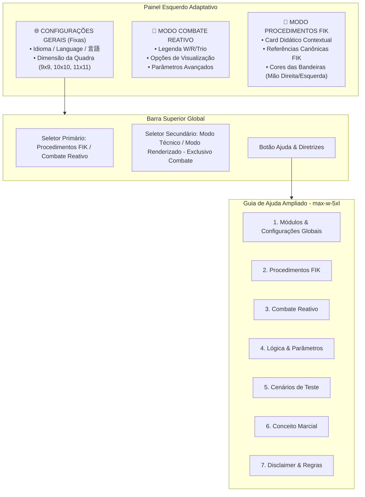

# Plano Formal de Implementação: Reestruturação do Guia de Ajuda e Reorganização Visual das Configurações

> **Status:** Aguardando Aprovação do Usuário para Execução  
> **Orientação Canônica:** Prof. Adrian Yoneda (Renshi 7º Dan — Brasil)  
> **Normas de Referência:** *FIK Regulations of Kendo Shiai and Shinpan* (Jul/2023) & *FIK Handbook for Kendo Shiai and Shinpan Management* (2025)

---

## 1. Visão Geral e Objetivos

Este plano tem como objetivo transformar o **Guia de Ajuda e Fundamentos** da aplicação em um manual interativo, visual e altamente didático, compatível com a evolução da plataforma (que agora contempla os dois grandes modos: **Procedimentos FIK** e **Combate Reativo**), além de reorganizar a interface do painel lateral esquerdo para separar de forma cristalina as **Configurações Globais** (comuns a ambos os módulos) das configurações específicas de cada módulo.

### Principais Entregas:
1. **Ampliação e Redesenho do Modal de Ajuda:**
   - Expansão da largura de `max-w-2xl` para `w-[94vw] max-w-5xl` com altura aproveitada `max-h-[88vh]`.
   - Layout em grade com cartões estilizados (*cards* com visual *glassmorphism*), tipografia destacada e badges visuais idênticos aos botões reais da interface.
   - Navegação por **7 abas temáticas**:
     1. `🌐 Módulos & Configurações Globais` (visão geral, objetivo dos 2 módulos, seletor de idioma e dimensões da quadra);
     2. `📜 Guia: Procedimentos FIK` (capítulos 1, 2, 2B, 3, controles de mídia, mesa, variantes e balões);
     3. `🥊 Guia: Combate Reativo` (interação com competidores, Modo Técnico vs. Modo Renderizado e opções de visualização);
     4. `📐 Lógica & Parâmetros Avançados` (suavização $k$, 5 limiares angulares/thresholds e estabilização de *tsubazeriai/freeze*);
     5. `🎮 Bateria de Cenários de Teste` (detalhamento didático dos 8 cenários automatizados);
     6. `🥋 Conceito Marcial & Fundamentos` (visão marcial do Prof. Adrian Yoneda, triângulo isósceles e sinergia arbitral);
     7. `⚖️ Disclaimer & Normas Oficiais` (natureza do modelo matemático, normas FIK e contato).
2. **Reorganização Visual da Interface (Painel Esquerdo Adaptativo):**
   - **Cabeçalho Fixo (Global):** Rotulado como *"Configurações Gerais"* com o seletor trilingue de idioma (`Idioma / Language / 言語`), seletor de tamanho da quadra (`9x9m`, `10x10m`, `11x11m`) e atalho de Ajuda.
   - **Corpo Adaptativo:**
     - Em **Combate Reativo**: exibe a legenda dos atletas, opções de visualização no quadra, parâmetros avançados e botão de reset dos lutadores.
     - Em **Procedimentos FIK**: oculta os controles de combate e exibe um **Cartão Didático Contextual FIK** com notas oficiais, orientação das bandeiras e referências espaciais do *Shiai-jo*.

---

## 2. Arquitetura da Solução e Componentes



---

## 3. Detalhamento das 7 Abas do Guia de Ajuda

### Aba 1: 🌐 Módulos & Configurações Globais
- **Apresentação:** O simulador integra a Plataforma Educacional de Kendo para preencher a lacuna de seminários presenciais de arbitragem.
- **Os 2 Grandes Módulos:**
  - `Procedimentos FIK`: protocolo canônico de entrada, rotações de posição e saída dos árbitros.
  - `Combate Reativo`: motor interativo onde o trio de árbitros reage dinamicamente aos atletas, preservando o triângulo isósceles.
  - Como alternar usando o seletor central do topo: badges visuais `[ 📜 Procedimentos FIK ]` e `[ 🥊 Combate Reativo ]`.
- **Configurações Globais Comuns:**
  - **Idioma (`Idioma / Language / 言語`):** Onde fica no cabeçalho esquerdo e como traduz instantaneamente comandos no canvas, abas, descrições e o próprio guia em Português, Inglês e Japonês.
  - **Dimensão da Quadra (`9x9 m`, `10x10 m`, `11x11 m`):** Explicação da proporção métrica. Destaca que nos Procedimentos a distância entre Fukushin é geometricamente preservada em 4m, enquanto a linha tangencial e posições de assentos se ajustam às dimensões reais da quadra.

### Aba 2: 📜 Guia de Uso: Procedimentos FIK
- **Objetivo:** Aprendizado visual e memorização da coreografia arbitral exata da FIK.
- **Navegação por Capítulos:**
  - *Capítulo 1:* Entrada, formação, avanço, *Ippomae*, *Rei* conjunto, deslocamento pelas pernas do trapézio isósceles e abertura das bandeiras.
  - *Capítulo 2:* Rotação regular sem troca (deslocamento simultâneo pelos lados do triângulo).
  - *Capítulo 2B:* Rotação com troca (*Shinpan Koutai*), entrada sincronizada do substituto, saudação mútua (*Rei*) e saída recuando.
  - *Capítulo 3:* Encerramento do shiai, retorno pelas pernas do trapézio, saudação final, meia-volta e saída com *Sogo-ni-rei*.
- **Controles de Operação:**
  - Barra de controle de reprodução: badges `[ Anterior ]`, `[ Reproduzir / Pausar ]`, `[ Próximo ]`, `[ Reiniciar ]`.
  - Controle de Velocidade: `[ 0.5x ]`, `[ 1.0x ]`, `[ 1.5x ]`, `[ 2.0x ]`.
  - Caixa didática: `[x] Pausar a cada etapa (Didático)` — como usar para estudo passo a passo.
  - Assentos da Mesa de Arbitragem: botões `[ Esquerda ]` e `[ Direita ]`.
  - Modo Rotação: botões `[ Regular ]` e `[ Troca ]`.
- **Linguagem Visual no Shiai-jo:**
  - Balões azuis `🗣️ "Mae"` / `"Rei"` (comandos audíveis do Shushin).
  - Badges âmbar `🤫 "Mae" (Voz Baixa)` (comandos discretos internos).
  - Badges verdes `🤫 Saudação mútua` / `Saudação à quadra` (ações em silêncio protocolar).
  - Linhas de apoio: trapézio isósceles (linha de entrada/saída por dentro dos *kaishisen*) e triângulo equilátero externo de *Sogo-ni-rei*.

### Aba 3: 🥊 Guia de Uso: Combate Reativo
- **Interação Básica:** Clicar e arrastar os círculos/atletas **W** (*Shiro* / Branco) e **R** (*Aka* / Vermelho) para avaliar a resposta imediata dos três árbitros.
- **Os 2 Modos de Visualização:**
  - *Modo Renderizado:* Visual zenital imersivo em dojo de madeira, atletas com fita Tasuki nas costas, e árbitros com postura ereta e bandeiras em mãos canônicas (Shushin: Vermelha na direita; Fukushin: Branca na direita).
  - *Modo Técnico:* Exibição puramente diagramática e vetorial (círculos W, R, S, F1, F2), linhas de visão, triângulo tracejado, áreas de responsabilidade poligonais e painel de depuração de ângulos em tempo real.
- **Opções de Visualização (Painel Esquerdo):**
  - Checkboxes: *Triângulo dos Árbitros*, *Eixo/Quadrado Dinâmico*, *Rótulos*, *Modo Debug*, *Indicadores de Direção*, *Trilhas de Movimento*.

### Aba 4: 📐 Lógica & Parâmetros Avançados
- **O Princípio do Triângulo Isósceles:** Shushin e dois Fukushin delimitando a ação dos atletas para maximizar o campo de visão e extinguir ângulos cegos.
- **Suavização ($k$):** Como a inércia algorítmica simula a passada e a massa corporal do árbitro (alto = reação instantânea; baixo = movimentação fluida e natural).
- **Os 5 Limiares Angulares (Thresholds):**
  - *Entrada Vertex ($90^\circ$):* ângulo em que o Shushin transita para a base do triângulo.
  - *Saída Vertex $\to$ Standard ($45^\circ$):* limiar com histerese para evitar oscilações desnecessárias.
  - *Entrada S_Base ($123^\circ$):* Shushin assume a base invertida.
  - *Saída S_Base $\to$ Vertex ($90^\circ$):* retorno ordenado para a zona Vertex.
  - *Entrada Flip ($135^\circ$):* inversão de quadrante para que os árbitros não colidam nem cruzem trajetórias.
- **Estabilização Interna (*Freeze*):**
  - Comportamento em corpo a corpo (*tsubazeriai*) ou giros rápidos sucessivos: o motor estabiliza os árbitros temporariamente para evitar corridas desnecessárias na quadra.

### Aba 5: 🎮 Bateria de Cenários de Teste
- **Como Operar:** Barra de cenários no canto inferior direito com botões compactos `[ 1A ]`, `[ 1B ]` ... `[ 5 ]` e botão `[ Parar ]`.
- **Guia Detalhado de cada Cenário:**
  - *1A: Giro Lento 360º* — valida a rotação contínua e preservação do triângulo isósceles.
  - *1B: Teste Vertex* — avalia a transição suave de entrada e saída na zona Vertex.
  - *1C: Teste S_BASE* — valida a postura e posicionamento do Shushin na base invertida.
  - *1D: Giro Reverso 360º* — testa a histerese angular em sentido horário vs. anti-horário.
  - *2: Taiatari Swap* — simula troca abrupta de posições dos competidores por choque corporal.
  - *3: Tsubazeriai Pião* — giro veloz em curta distância para disparo do algoritmo de *Freeze*.
  - *4 e 5: Inversões perto de 90º e 135º* — validação das fronteiras angulares críticas sem quebra da geometria.

### Aba 6: 🥋 Conceito Marcial & Fundamentos
- **Filosofia de Arbitragem:** *"Acredito que o árbitro deve naturalizar sua movimentação para liberar sua mente para o julgamento correto do ippon."* (Prof. Adrian Yoneda — Renshi 7º Dan).
- **Sinergia do Trio:** A arbitragem em Kendo não é individual; o mau posicionamento de um árbitro compromete a visibilidade dos outros dois.
- **Geometria Dinâmica:** Como o deslocamento preventivo permite ao árbitro enxergar a linha exata de impacto do *shinai* nos alvos válidos (*Men*, *Kote*, *Do*, *Tsuki*).

### Aba 7: ⚖️ Disclaimer & Referências Oficiais
- **Aviso Legal e Didático:** A ferramenta é um modelo educacional/matemático complementar, não substituindo o critério e a vivência com mestres e árbitros graduados.
- **Bibliografia Canônica:**
  - *Regulations of Kendo Shiai and Shinpan* (FIK, Jul/2023)
  - *Handbook for Kendo Shiai and Shinpan Management* (FIK, Jul/2025)
- **Créditos:** Adrian Yu Yoneda (Renshi 7º Dan Kendo / 5º Dan Iaido — São Paulo, Brasil).

---

## 4. Tarefas de Implementação

### Tarefa 1: Reestruturação do Modal no `index.html` e CSS
- Ampliar o contêiner do modal `#help-modal` para `w-[94vw] max-w-5xl max-h-[88vh]`.
- Atualizar a barra de abas de navegação para os novos 7 identificadores com ícones (`data-tab="global"`, `"procedures"`, `"combat"`, `"advanced"`, `"scenarios"`, `"concept"`, `"disclaimer"`).
- Adicionar estilos dedicados para caixas didáticas, badges de botões simulados e tabelas explicativas no `src/index.css`.

### Tarefa 2: Reorganização Visual do Painel Esquerdo no `index.html` e `src/main.ts`
- No cabeçalho fixo do painel esquerdo:
  - Adicionar o bloco delimitado *"Configurações Gerais"* contendo Idioma (`Idioma / Language / 言語`), Dimensão da Quadra (`9x9m`, `10x10m`, `11x11m`) e atalho de Ajuda.
- No corpo do painel esquerdo:
  - Criar o bloco `#combat-controls-container` contendo os controles exclusivos de combate (legenda dos lutadores, checkboxes de visualização, sliders de thresholds e botão de reset dos lutadores).
  - Criar o bloco `#procedure-context-container` contendo o cartão didático contextual FIK.
- No `src/main.ts`:
  - Na função `setSimulationMode()`:
    - Se `mode === 'COMBAT'`: exibe `#combat-controls-container` e oculta `#procedure-context-container`.
    - Se `mode === 'PROCEDURE'`: exibe `#procedure-context-container` e oculta `#combat-controls-container`.

### Tarefa 3: Enriquecimento dos Conteúdos das 7 Abas em `src/i18n.ts`
- Escrever o conteúdo completo, formatado e visual das 7 abas em português (`pt`).
- Criar a estrutura espelhada em inglês (`en`) e japonês (`jp`) garantindo termos canônicos e que nenhuma aba quebre ao alternar idiomas.
- Atualizar as referências de abas no `src/main.ts` (`setActiveHelpTab`).

### Tarefa 4: Validação Automatizada e no Navegador
- Executar a bateria de testes unitários (`npx vitest run`) garantindo 30/30 testes passando.
- Executar build de produção (`npm run build`).
- Executar subagente no navegador para validar visualmente o modal ampliado, a navegação entre as 7 abas e a alternância contextual do painel esquerdo.

---

## 5. Plano de Verificação

### Testes Automatizados
```bash
npx vitest run
npm run build
```

### Verificação Manual Interativa (Navegador)
1. **Verificar Inicialização:**
   - Confirmar se o simulador parte em modo Procedimentos FIK.
   - Confirmar se o painel esquerdo exibe o bloco de *"Configurações Gerais"* no topo e o *"Cartão Contextual FIK"* no corpo, sem botões de reset de atletas ou checkboxes de combate.
2. **Alternar para Combate Reativo:**
   - Confirmar se o corpo do painel esquerdo transiciona instantaneamente para exibir a legenda de lutadores, checkboxes e parâmetros de combate.
3. **Abrir Guia de Ajuda:**
   - Clicar no botão `Ajuda` e conferir a nova largura confortável (`max-w-5xl`).
   - Navegar pelas 7 abas confirmando layout, formatação rica, badges visuais idênticos aos botões e clareza didática.
4. **Verificar Multilíngue:**
   - Alternar para Inglês (`en`) e Japonês (`jp`) e confirmar consistência das abas e conteúdos.
